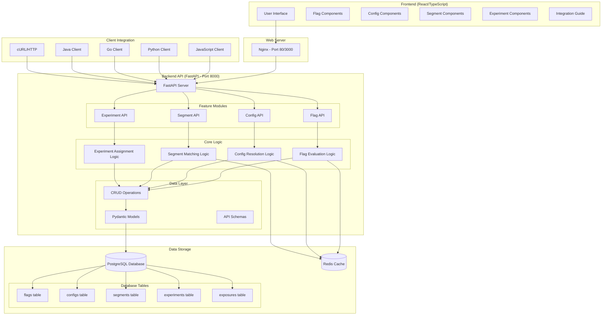
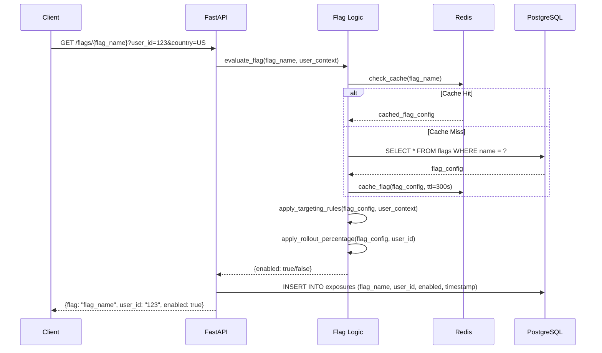
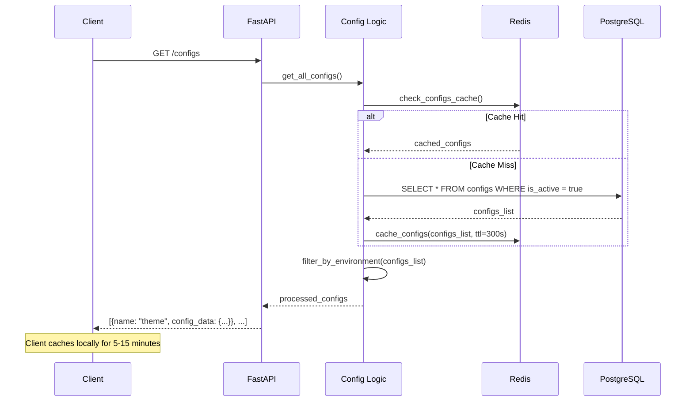
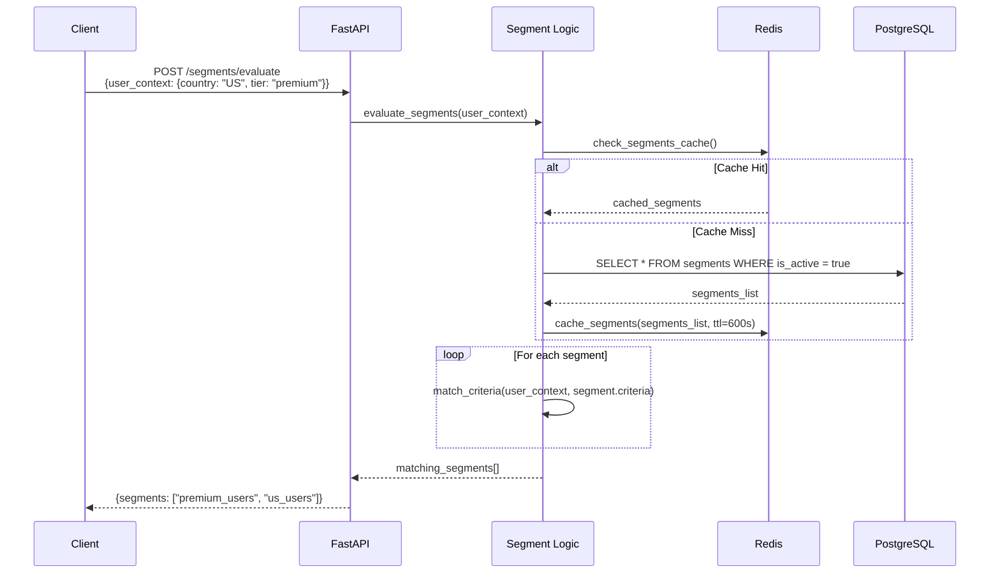
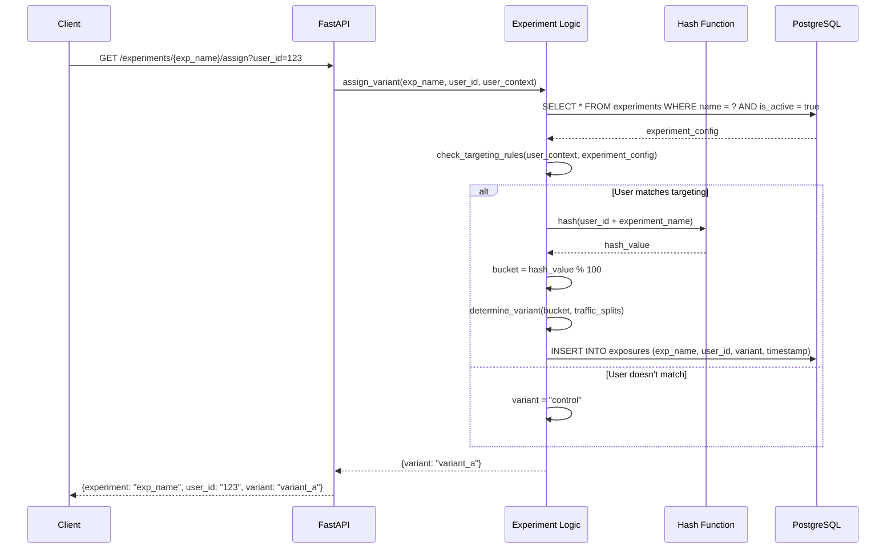
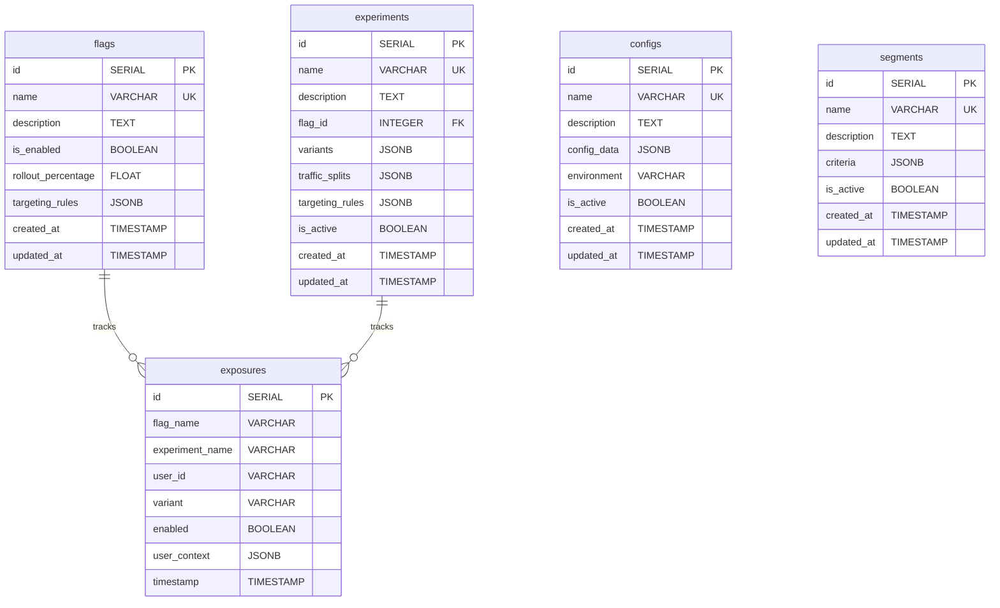
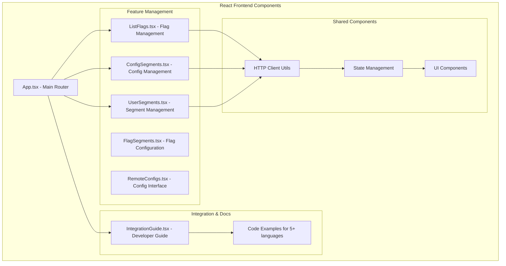
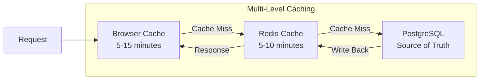
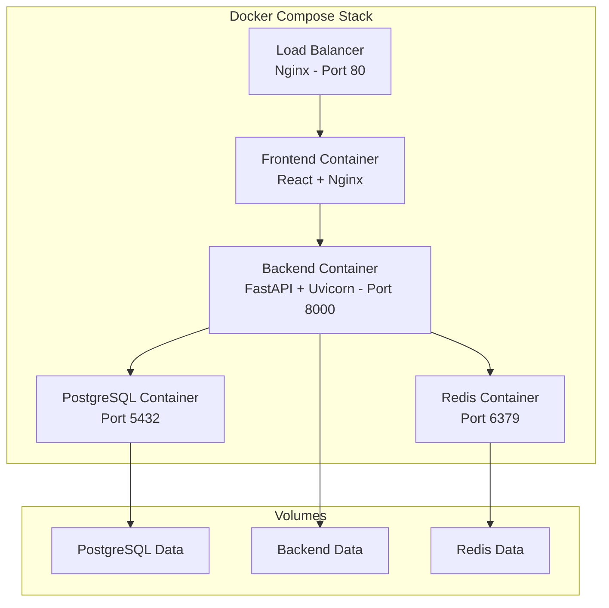

# OptiFork Architecture Diagram

## System Overview



## Feature Architecture Deep Dive

### 1. Feature Flags System



**Location**: `/backend/crud.py:check_flag()` and `/backend/main.py:/flags/{flag_name}`

### 2. Remote Configs System



**Location**: `/backend/crud.py:get_configs()` and `/backend/main.py:/configs`

### 3. User Segments System



**Location**: `/backend/crud.py:get_segments()` and `/backend/main.py:/segments`

### 4. A/B Testing Experiments



**Location**: `/backend/crud.py:assign_experiment()` and `/backend/main.py:/experiments/{experiment_name}/assign`

## API Endpoints Reference

### Feature Flags APIs
```
📍 File Location: /backend/main.py (lines 100-150)

GET    /flags                     # List all flags
POST   /flags                     # Create new flag
GET    /flags/{flag_name}         # Evaluate flag for user
PUT    /flags/{flag_name}         # Update flag
DELETE /flags/{flag_name}         # Delete flag
GET    /flags/{flag_name}/exposures # Get flag exposure data
```

### Remote Configs APIs
```
📍 File Location: /backend/main.py (lines 200-250)

GET    /configs                   # List all configs
POST   /configs                   # Create new config
GET    /configs/{config_id}       # Get specific config
PUT    /configs/{config_id}       # Update config
DELETE /configs/{config_id}       # Delete config
```

### User Segments APIs
```
📍 File Location: /backend/main.py (lines 300-350)

GET    /segments                  # List all segments
POST   /segments                  # Create new segment
GET    /segments/{segment_id}     # Get specific segment
PUT    /segments/{segment_id}     # Update segment
DELETE /segments/{segment_id}     # Delete segment
POST   /segments/evaluate         # Evaluate user against segments
```

### Experiments APIs
```
📍 File Location: /backend/main.py (lines 400-450)

GET    /experiments               # List all experiments
POST   /experiments               # Create new experiment
GET    /experiments/{exp_name}/assign # Assign user to variant
GET    /experiments/{exp_name}/results # Get experiment results
PUT    /experiments/{exp_name}    # Update experiment
```

## Database Schema



**Location**: `/backend/models.py` and `/backend/db.py`

## Frontend Component Architecture



**Locations**: 
- `/frontend/src/App.tsx` - Main application component
- `/frontend/src/components/` - All feature components
- `/frontend/src/components/IntegrationGuide.tsx` - Developer documentation

## Data Flow Examples

### 1. Creating a Feature Flag
```
User Input (Frontend) 
    ↓ POST /flags
FastAPI Validation (backend/schemas.py)
    ↓ 
Business Logic (backend/crud.py:create_flag())
    ↓
Database Insert (PostgreSQL flags table)
    ↓
Cache Invalidation (Redis)
    ↓ 
Response to Frontend
```

### 2. Evaluating a Flag for User
```
Client Request: GET /flags/new_feature?user_id=123&country=US
    ↓
API Route Handler (backend/main.py:check_flag())
    ↓
Cache Check (Redis: flag:new_feature)
    ↓ (if miss)
Database Query (PostgreSQL: SELECT * FROM flags...)
    ↓
Targeting Rules Evaluation (backend/crud.py:evaluate_targeting())
    ↓ 
Rollout Percentage Check (hash-based bucketing)
    ↓
Exposure Logging (PostgreSQL: INSERT INTO exposures...)
    ↓
Response: {enabled: true/false}
```

### 3. Segment-based Configuration
```
Client: GET /configs (with user context in headers)
    ↓
Segment Evaluation (determine which segments user belongs to)
    ↓
Config Resolution (check for segment-specific configs first)
    ↓ 
Fallback to General Config (if no segment-specific config exists)
    ↓
Response: Merged configuration object
```

## Caching Strategy



## Security & Performance

### Rate Limiting
```
📍 Location: /backend/main.py (middleware setup)

- API requests: 1000/hour per IP
- Flag evaluations: 10000/hour per user
- Config fetches: 100/hour per client
```

### Authentication (Future)
```
- API Key based authentication
- JWT tokens for user context
- Role-based permissions for admin features
```

### Performance Optimizations
```
1. Redis caching for frequently accessed data
2. Connection pooling for PostgreSQL
3. Async/await for non-blocking I/O
4. Database indexes on frequently queried fields
5. Client-side caching with TTL
```

## Deployment Architecture



**Location**: `/docker-compose.yml` - Complete orchestration setup

## Getting Started - Quick Reference

### 1. Start the System
```bash
docker-compose up -d
```

### 2. Access Points
- **Frontend**: http://localhost (port 80)
- **API Docs**: http://localhost:8000/docs  
- **API Base**: http://localhost:8000

### 3. Example API Calls
```bash
# Check a flag
curl "http://localhost:8000/flags/new_feature?user_id=123&country=US"

# Get configs
curl "http://localhost:8000/configs"

# Create a segment
curl -X POST "http://localhost:8000/segments" \
  -H "Content-Type: application/json" \
  -d '{"name": "premium_users", "criteria": {"tier": "premium"}}'
```

This architecture supports scalability, maintainability, and provides a clear separation of concerns between feature management, configuration, user segmentation, and experimentation.

---

# Phase 0 — Runtime Architecture Analysis (as-built, derived from code)

> This section is authoritative for the hardening effort and is derived strictly from the
> current code (`backend/`), not from the aspirational prose above. Where the two disagree,
> **this section wins**. In particular, the earlier "Caching Strategy", "Rate Limiting", and
> parts of the diagram describe subsystems that are **commented out of `backend/main.py`**
> and therefore not active today (see `FEATURES.md` → "Present in repo but disabled").

## 1. How a flag decision is made

**A server API call per evaluation.** There is no SDK and no local/edge evaluation.
A client calls `GET /flags/{flag_name}?user_id=<id>&<trait>=<val>...` and the server
(`evaluate_flag` in `backend/main.py:204`) does, per request:

1. Load the flag + its rules from the DB (`crud.get_flag_by_name`, `selectinload(rules)`).
2. Build a `UserContext` from the query params.
3. **Segments first**: `crud.find_matching_segments` loads all of the flag's
   `flag_segments` (ordered by priority), and for each enabled one re-loads the segment by
   id and evaluates its JSON conditions in Python (`evaluate_user_segment`). First match
   wins; a per-user hash is compared to that segment's `rollout_percentage`.
4. **Else legacy rules**: if the flag has rules and the user fails them, return disabled.
5. **Else rollout bucket**: `enabled = (sha256(user_id) % 10000)/10000 < flag.rollout`.
6. **Write an exposure row** (`flag_exposures`) synchronously with `commit()`, then return.

Config evaluation (`GET /configs/evaluate/{key}`) follows the same shape and also writes a
`config_exposures` row per call.

**Scale-relevant properties:**
- Every decision is ≥1 DB read; with segments it is **N+1**: one query for the flag's
  associations plus one `get_user_segment_by_id` per association, each awaited serially.
- Every decision is also **1 write + commit** (exposure logging is inline and unconditional,
  on the request's hot path). There is no batching, no async queue, no sampling.
- Segment conditions are evaluated in Python, not in SQL.
- No in-process or Redis cache is consulted (cache module disabled).

## 2. How flag config reaches clients, and how fast

There is **no push/propagation mechanism**. Clients get current values only by making another
evaluation API call. Consequences:

- A flag change is "propagated" as soon as the next evaluation call reads the DB — i.e. config
  freshness equals the client's own polling cadence; the server does nothing to notify.
- No streaming, no long-poll, no webhooks, no ETag/`Last-Modified`/`Cache-Control` (confirmed
  absent by grep). No client-side config bootstrap/snapshot endpoint.
- The frontend console fetches full collections (`GET /flags`, `/configs`, …) on mount with no
  caching headers.

## 3. Whether and how exposures/events are recorded

Recorded, synchronously, in the primary DB:
- **Flag exposures** → `flag_exposures` on every `GET /flags/{name}` evaluation
  (`crud.log_flag_exposure`): `flag_id`, `flag_name`, `user_id`, `enabled` (stored as the
  **string** `"true"`/`"false"`), `segment_id`, `timestamp`.
- **Config exposures** → `config_exposures` on every config evaluation.
- **Experiment exposures** → `exposures` only when `POST /experiments/{name}/exposure` is
  called explicitly (not on assignment).

Reads: `GET /exposures`, `/flags/{name}/exposures`, `/configs/exposures` — each
`ORDER BY timestamp DESC LIMIT n`. **`timestamp` is not indexed**, so these degrade to a full
scan + sort as the tables grow. There is no rollup/aggregation table; `/experiments/results`
computes counts with a `COUNT(*)` per variant in a Python loop (N+1).

## 4. Caching

**None active.** `backend/cache.py` (Redis) is imported-but-commented in `main.py`; `init_cache`
and `warm_up_cache` are not called. No response caching, no query cache, no memoization. Redis
is present in compose files but unused by the running app.

## 5. Connection pooling

Configured in `backend/db.py` by database type:
- **PostgreSQL** (async `asyncpg`): `pool_size=10`, `max_overflow=20`, `pool_pre_ping=True`,
  `pool_recycle=3600`. A separate **sync** engine (`psycopg2`) with `pool_size=5`,
  `max_overflow=10` exists solely for the Snowflake connector.
- **SQLite** (default, async `aiosqlite`): no real pool; `check_same_thread=False`; `echo=True`
  (SQL logging on — noisy/slow, not a prod setting).

So the effective ceiling for the async app on Postgres is ~30 concurrent DB connections from a
single backend process.

## 6. Worker model

- Backend container runs **a single Uvicorn process, no `--workers`** (`backend/Dockerfile`
  CMD `uvicorn main:app --host 0.0.0.0 --port 8000`; neither compose file overrides it). So one
  event loop, one process — no multi-worker or multi-process parallelism out of the box, and no
  Gunicorn supervisor.
- FastAPI route handlers are `async`; DB access is async (`asyncpg`/`aiosqlite`). CPU-bound
  work (hashing, Python condition evaluation) runs on the single loop thread.
- Snowflake export uses FastAPI `BackgroundTasks` (in-process, same lifecycle as the server).
- `scheduler.py` (APScheduler) is disabled, so there are no periodic background jobs.

## 7. Database indexes (as-built)

Only single-column indexes from `index=True` / `unique=True`; **no composite indexes, no
migrations** (tables created via `Base.metadata.create_all` at startup):

| Table | Indexed columns | Notable gaps for scale |
|---|---|---|
| `feature_flags` | `name` (unique), `id` | list has no pagination |
| `user_segments` | `name` (unique), `id` | — |
| `flag_segments` | `id` | no index on `flag_id` → per-flag lookup scans |
| `remote_configs` | `key` (unique), `id` | — |
| `config_segments` | `id` | no index on `config_id` |
| `flag_exposures` | `flag_name`, `user_id`, `id` | **`timestamp` unindexed** (sorted on) |
| `config_exposures` | `config_key`, `user_id`, `id` | **`timestamp` unindexed** |
| `experiments` | `name` (unique), `id` | — |
| `variants` | `id` | no index on `experiment_id` |
| `user_assignments` | `user_id`, `id` | no composite `(experiment_id, user_id)` for sticky lookup |
| `exposures` | `user_id`, `id` | no index on `experiment_id`/`variant_id`/`timestamp` |

## 8. Concurrency & resilience (as-built)

- **No optimistic concurrency / versioning.** `update_flag` / `update_remote_config` /
  `update_user_segment` are read-modify-write with no version column or conditional update, so
  two concurrent edits to the same flag silently last-writer-wins (relevant to the Phase 2
  "no lost updates" target).
- **No last-known-good fallback.** Clients have no local cache; if the backend/DB is down,
  evaluation calls simply fail (relevant to the Phase 2 resilience target).
- **Default store is SQLite**, single-writer; Postgres is opt-in via `DATABASE_URL`. Load tests
  (Phase 1) must run against the Postgres-backed Docker prod build, per the goal.

## 9. Request path summary

```
Client ──HTTP──> Nginx (frontend container, static SPA)         # UI only
Client ──HTTP──> Uvicorn (1 proc) ─> FastAPI ─> crud ─> SQLAlchemy async ─> DB (SQLite|Postgres)
                                           └─> (inline) exposure INSERT + COMMIT
No cache · no queue · no SDK · no config push · no auth layer.
```
